# Calculator
### A basic calculator Python app using Tkinter library.

> [!WARNING]
> **Your antivirus and Windows' Smart App Control may flag the `.exe` file as suspicious and potentially send it to quarantine.** 
> If it happens, make sure to set an exception for this file and/or temporarily turn off the Smart App Control in Windows Security to open the `.exe`. 
> The program is open-source meaning you can always examine the code yourself before executing the application.

This project was made for fun, mainly to exercise coding in Python and using new libraries (like Tkinter). It also helped me to understand better object programming. 
The application is **fully resizable** with the minimal size set.

| Normal mode | Advanced mode | Physics mode | Full extended mode |
|:-----------:|:-------------:|:------------:|:------------------:|
| 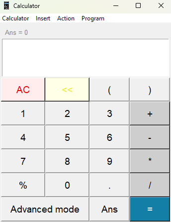 | 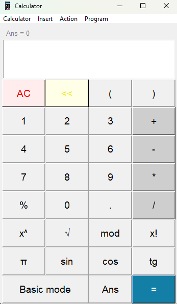 | 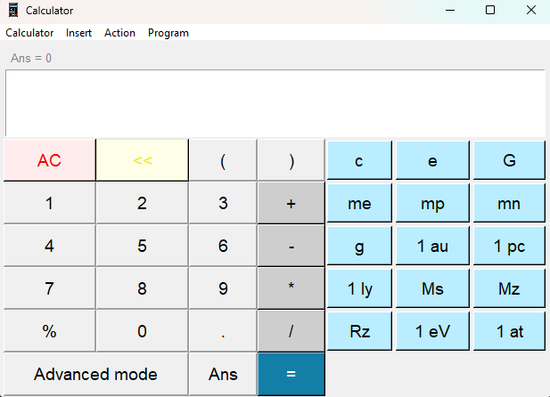 | 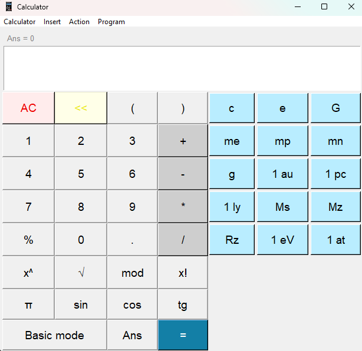 |

> [!NOTE]
> This program was tested on Windows only (Windows 11). 
> There is no guarantee that the program will work on other systems (eg. MacOS or Linux).

## Most useful keybinds:
- `0` - `9` - numbers from 0 to 9
- `Esc` - clear / clear all
- `Backspace` - erase last symbol
- `+`, `-`, `*`, `/` - addiction, substraction, multiplication, division
- `^`, `v` - power, square root
- `p` - pi
- `Tab` - switch between Normal and Advanced modes
- `'` - turn on/off Physics mode
- `s`, `c`**a**, `t` - sinus, cosinus, tangens
- `a` - answer (of previous equation saved in memory)
- `m` - modulo (remainder) [%]
- `!` - Newton
- `e`**b** - elementary charge [C]
- `g`**b** - Earth's gravitational acceleration [m/s2]
- `G`**b** - gravitational constant [N⋅m2/kg2]

You can find all a list of all keybinds in `Calculator -> Settings -> Keybinds`.

> **a** - if Physics mode is on: speed of light [m/s]. 
> **b** - works only if Physics mode is on.

| Keybinds tab |
|:-----------:|
| 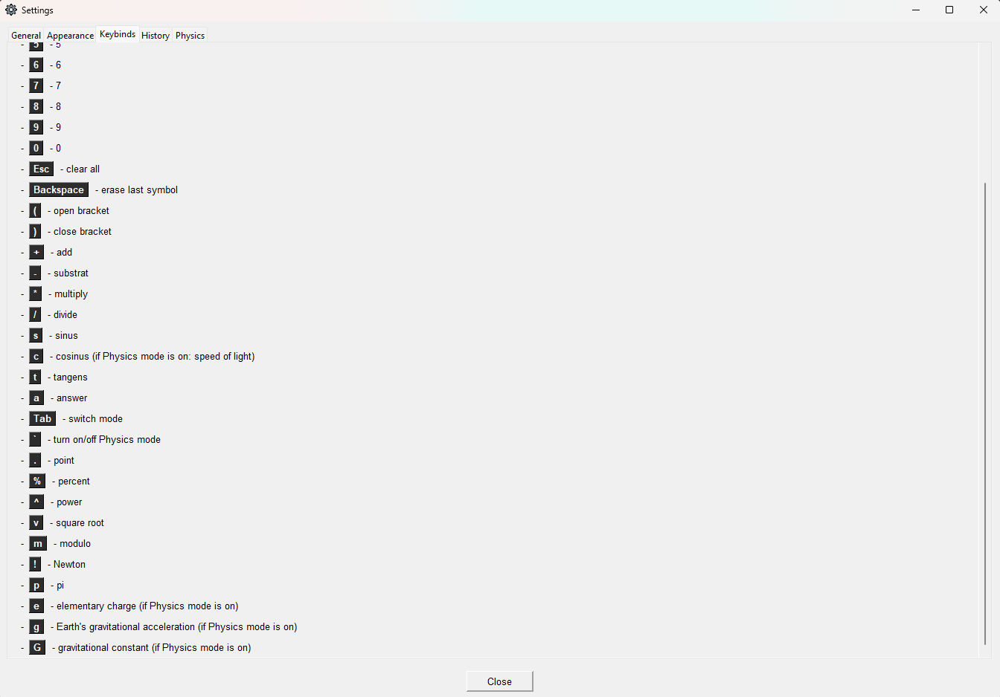 |

## Themes
There are various themes you can set in Settings:
- Blue
- Red
- Orange
- Green
- Purple
- Black
- Twilight
- Frost

| Themes tab |
|:-----------:|
| 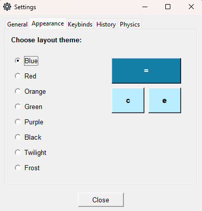 |

**Various themes examples:**

| Red | Orange | Frost |
|:---:|:------:|:-----:|
| 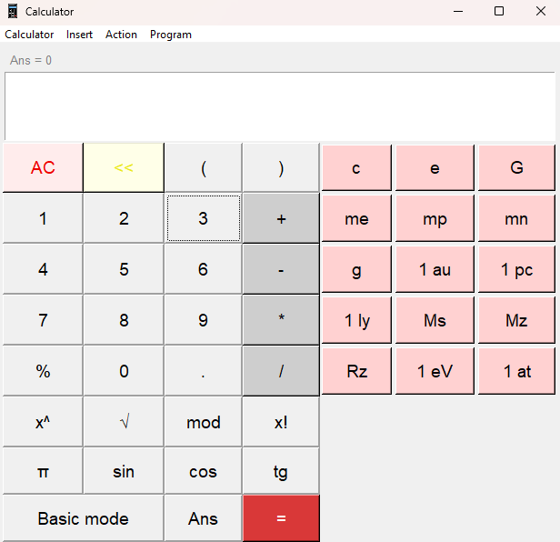 | 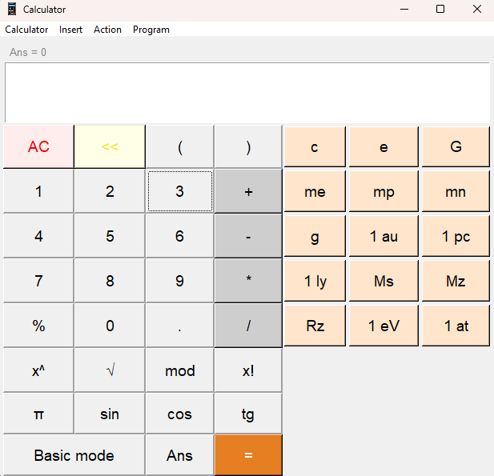 | 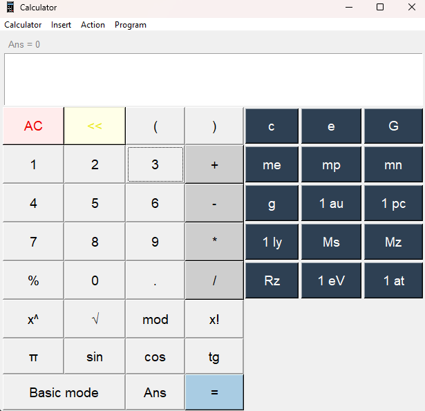 |

## History
You can view and delete your history of performed equations in Settings.

| History tab |
|:-----------:|
| 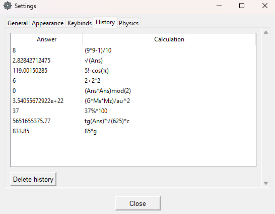 |

## Physics
You can also edit all Physics constant variables in Settings.

| Physics tab | Physics topbar |
|:-----------:|:--------------:|
| 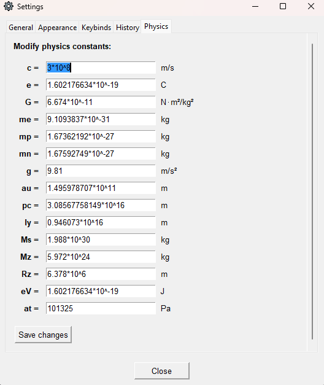 | 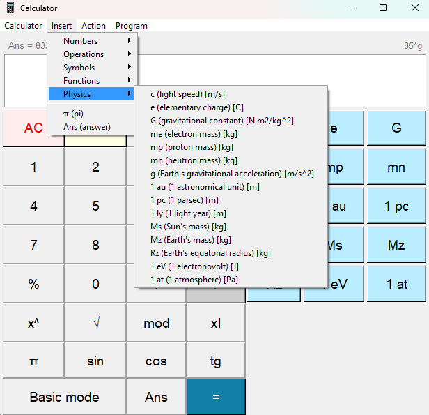 |

> [!TIP]
> If you are willing to download the source code (`Calculator.py`) and run it with your own interpreter: 
> - if you're using **Windows** or **MacOS** you shouldn't encounter any problems. All libraries are installed by default.
> - if you're using **Linux Debian/Ubuntu** you may need to install Tkinter first with `sudo apt install python3-tk`.

> [!NOTE]
> Some of the symbols of variables in the Physics mode are written in **Polish**. 
> You can see the English meaning of each one in the topbar (`Insert -> Physics`).

**Versions:**

| VERSION | CHANGES |
| -------- | ------- |
| 0.2| <ul><li>added comma (`.`) new functionality based on what has already been writtem on calculator preventing repeated or wrong usage of comma;</li><li>added autofill with `0.` when clicking a comma button without any number behind it;</li><li>supported the single file export (`.exe`);</li><li>minor language fixes.</li></ul>|
| 0.1 | <ul><li>created an app.</li></ul> |

You can see details about version releases in `Program -> Versions -> Version 0.X`.

| Versions topbar |
|:-----------:|
| 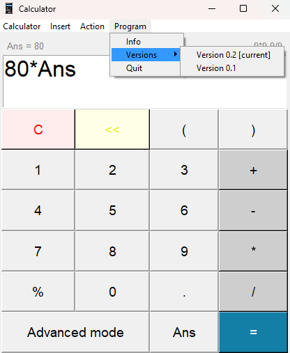 |
